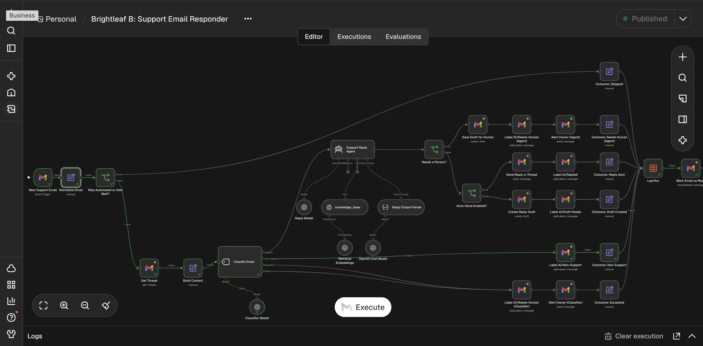
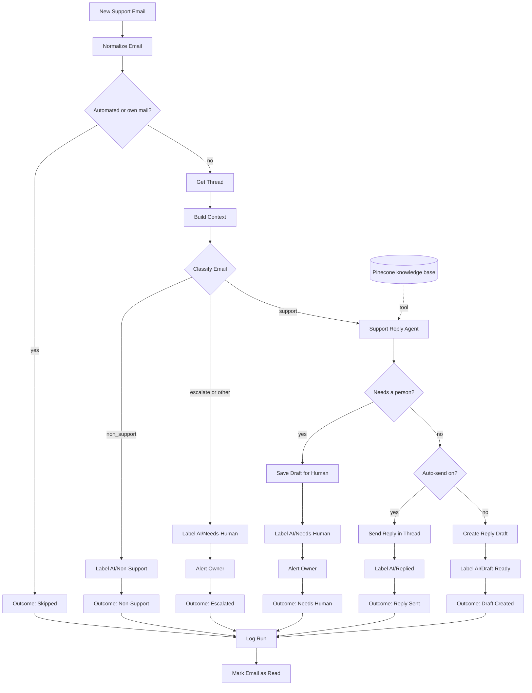

# Brightleaf Support Desk: AI email triage and reply drafting in n8n

An n8n workflow set that reads customer emails in Gmail, decides whether each one is a support request, and drafts a reply from a Pinecone knowledge base in the same thread, with a person kept in the loop for anything risky.



## What I built

Small shops usually answer the same few questions all day: where is my order, can I return this, how do I pause my subscription. The answers already exist in a policy page somewhere, but someone still has to read each email, find the answer and type it out. This project does the reading and the first draft, and leaves the decision to send with a person unless they choose otherwise.

The trigger is a Gmail poll that picks up unread mail carrying a `Brightleaf-Support` label. Each email is cleaned up, checked against a few automation signals (out-of-office replies, bulk mail, mail the inbox sent itself), then classified by an OpenAI model as support, non-support or escalate. Support emails go to an AI agent that searches the knowledge base in Pinecone and writes a reply. The reply is saved as a draft in the original Gmail thread, or sent automatically if you switch that setting on. Every email ends with a label, a row in a log table, and a mark as read.

## How it works

The project is three workflows. A loads the knowledge base, B handles the email, and C reports failures.

1. **Brightleaf A: Knowledge Base Ingest.** A manual run. The `Knowledge Base Documents` Code node holds eight short policy documents. `Document Loader` and `Chunk Splitter` cut them into chunks, `OpenAI Embeddings` turns the chunks into vectors, and `Store in Pinecone` writes them into the `brightleaf-kb-v1` namespace, clearing it first so a re-run never duplicates anything.
2. **New Support Email** (B) polls Gmail every minute for unread messages with the `Brightleaf-Support` label.
3. **Normalize Email** pulls out the sender, subject, a plain-text body capped at 4,000 characters, and two flags for automated and own mail. It also holds the two settings you are most likely to change, `autoSend` and `ownerEmail`.
4. **Skip Automated or Own Mail?** sends automated mail straight to the log and mark-as-read steps.
5. **Get Thread** and **Build Context** fetch earlier messages in the thread and combine them with the new email into one block of text.
6. **Classify Email** (Text Classifier with `Classifier Model`) sorts the email into support, non_support or escalate. Anything it cannot place goes to the escalate path. The prompt tells it to treat the email as data and to choose escalate if the email contains instructions aimed at an AI.
7. **Support Reply Agent** answers support emails. It has `knowledge_base` as a tool (Pinecone with `Retrieval Embeddings`), and `Reply Output Parser` forces a structured result with the reply, a confidence level, a needs_human flag and a reason.
8. **Needs a Person?** checks that result. If the agent flagged it, gave low confidence or wrote nothing, the reply is saved as a draft, the email is labeled `AI/Needs-Human`, and an alert email goes to the owner.
9. Otherwise **Auto-Send Enabled?** either sends the reply in the thread and labels it `AI/Replied`, or saves a draft and labels it `AI/Draft-Ready`.
10. Non-support mail is labeled `AI/Non-Support`. Escalated mail is labeled `AI/Needs-Human` and an alert goes to the owner, with no reply written.
11. **Log Run** writes one row per email to an n8n Data Table, then **Mark Email as Read** closes the loop so the poll does not pick it up again.
12. **Brightleaf C: Error Handler** is set as the error workflow on A and B. If either fails, it emails the failed node, the error message and a link to the execution.



## Key benefits

- Every support email gets a first draft written from the written policies, so the person replying edits instead of starting from nothing.
- Replies stay in the original Gmail thread, so the customer sees one conversation.
- Allergy, health, legal and payment-dispute questions, messages not in English and prompt-injection attempts are routed to a person instead of getting an automated answer.
- When the knowledge base has no answer, the agent is told to say so and flag it, not to guess. Gift cards are deliberately missing from the demo knowledge base to test exactly that.
- Each email leaves a label in Gmail and a row in a log table, so it is easy to see what happened to it.

## Tech stack

- n8n (cloud or self-hosted, with Data Tables available)
- Gmail (trigger, labels, drafts, replies, alerts)
- OpenAI chat model `gpt-4o-mini` for classification, reply writing and output repair, plus OpenAI embeddings
- Pinecone, as a classic dense vector index with 1536 dimensions and the cosine metric
- n8n Data Table for the run log

## Setup

The short version is below. The full steps are in [docs/setup.md](docs/setup.md) and the credentials are explained in [docs/credentials.md](docs/credentials.md).

1. Create a classic Pinecone index named `brightleaf-kb` (1536 dimensions, cosine).
2. Create the five Gmail labels and the `Brightleaf Support Log` Data Table.
3. Import the three files in `workflows/` into n8n and create the Gmail, OpenAI and Pinecone credentials.
4. Replace the `YOUR_` placeholders listed in the setup guide.
5. Run workflow A once, then attach workflow C as the error workflow for A and B.
6. Test with the emails in [docs/testing.md](docs/testing.md) before activating B.

## Example

An email from a customer asking about shipping time comes in with the label applied. The classifier returns `support`, the agent searches the knowledge base and returns a result like this, and a draft appears in the thread with the `AI/Draft-Ready` label:

```json
{
  "reply": "Hello Sam, orders leave our warehouse within 1 to 2 business days and arrive 3 to 7 business days after dispatch. We email a tracking link as soon as your order ships. Brightleaf Support",
  "confidence": "high",
  "needs_human": false,
  "reason": "Answered from the shipping policy",
  "sources_used": ["01 Shipping Policy"]
}
```

The full input and output are in [sample-data/](sample-data/). They are made up and shaped from the node fields.

## Customizing it

- **Send instead of draft:** set `autoSend` to `true` in `Normalize Email`. I would keep drafts until the replies have been checked on real mail.
- **Where alerts go:** set `ownerEmail` in `Normalize Email` and `alertEmail` in the error workflow's `Alert Settings`.
- **Tone and rules:** edit the system message in `Support Reply Agent`.
- **What counts as support or escalate:** edit the category descriptions in `Classify Email`.
- **Your own knowledge base:** replace the documents in the `Knowledge Base Documents` Code node, or swap that node for a Google Drive or file source, then run workflow A again.
- **Poll speed:** change the interval on `New Support Email`.

## Limitations

- Support only works from what is in the knowledge base, which here is eight short invented documents. A real shop would need real policies loaded in.
- The agent cannot see orders, tracking or accounts, so it can only ask for an order number and explain policy.
- The classifier and agent are language models, so they will sometimes be wrong. That is why drafts are the default and why risky topics go to a person.
- Messages that are not in English are escalated, not answered.
- The loop only looks at mail that already carries the `Brightleaf-Support` label, so you need a Gmail filter or rule to apply it.
- Gmail polling means a delay of up to the poll interval before a new email is picked up.
- I have not measured accuracy or time saved, so I am not claiming either.

## Conclusion

This project shows the full path from an incoming email to a safe, reviewable reply: ingestion, classification, retrieval, drafting, escalation and logging, with error handling on top. The part I paid most attention to was what the workflow does when it is unsure, because that decides whether a person would trust it with a real inbox. Next I would add a feedback step that records when a person edits a draft, so the knowledge base and the prompts can be improved from real corrections.

## Author

Built by Paidamoyo
