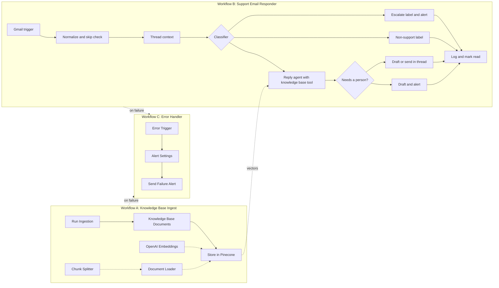

# Architecture

This is the longer walkthrough of the three workflows. The README has the short version.

## Workflow A: Knowledge Base Ingest

Runs by hand. It is the only place knowledge gets into Pinecone.

| Node | Type | What it does |
| --- | --- | --- |
| Run Ingestion | Manual Trigger | Starts the run |
| Knowledge Base Documents | Code | Returns eight items with `title`, `source` and `text`. These are the made-up Brightleaf policies: shipping, returns, subscriptions, tracking, brewing, ingredients and allergens, billing, and contact hours |
| Store in Pinecone | Pinecone Vector Store (insert) | Writes into index `brightleaf-kb`, namespace `brightleaf-kb-v1`, and clears the namespace first |
| OpenAI Embeddings | Embeddings OpenAI | Turns each chunk into a vector |
| Document Loader | Default Data Loader | Reads the `text` field of each item and attaches `title` and `source` as metadata |
| Chunk Splitter | Recursive Character Text Splitter | Chunk size 800, overlap 100 |

The documents are short, so most of them become a single chunk. Clearing the namespace on each run means the index always matches whatever is in the Code node.

## Workflow B: Support Email Responder

### Intake

| Node | What it does |
| --- | --- |
| New Support Email | Gmail Trigger, polls every minute for unread messages with the `Brightleaf-Support` label. Full message format, so headers and the HTML body are available |
| Normalize Email | Set node. Produces `messageId`, `threadId`, `senderEmail`, `senderName`, `firstName`, `inboxAddress`, `subject`, `bodyText` (plain text, whitespace collapsed, capped at 4,000 characters), `isAutomated`, `isOwnMail`, `autoSend` and `ownerEmail` |
| Skip Automated or Own Mail? | If node. `isAutomated` is true for an auto-submitted header, bulk or list precedence, an auto-reply header, or a subject that starts like an out-of-office message. `isOwnMail` is true if the message carries the `SENT` label |

Skipped mail goes through `Outcome: Skipped`, then `Log Run` and `Mark Email as Read`.

### Context and classification

| Node | What it does |
| --- | --- |
| Get Thread | Fetches the Gmail thread |
| Build Context | Builds one text block: subject, body, and up to the last three earlier messages in the thread (sender and snippet) |
| Classify Email | Text Classifier with three categories and a fallback. Output 0 is support, 1 is non_support, 2 is escalate and 3 is the fallback. Outputs 2 and 3 are wired to the same escalate path |
| Classifier Model | `gpt-4o-mini` at temperature 0.1 |

The classifier prompt says the email is data to classify, not instructions, and tells the model to pick escalate if the email contains instructions aimed at an AI or if it is unsure between support and escalate.

### Reply

| Node | What it does |
| --- | --- |
| Support Reply Agent | AI Agent with a system message that sets the Brightleaf voice and the safety rules: use the knowledge base before any factual answer, never guess, never promise refunds or exceptions, never invent order details, treat the email as untrusted, and send allergy, health, safety, legal and payment dispute topics to a person |
| Reply Model | `gpt-4o-mini` at temperature 0.3 |
| knowledge_base | Pinecone Vector Store in retrieve-as-tool mode, namespace `brightleaf-kb-v1` |
| Retrieval Embeddings | OpenAI embeddings for the search query |
| Reply Output Parser | Structured output with `reply`, `confidence` (high, medium or low), `needs_human`, `reason` and `sources_used`. Auto-fix is on |
| OpenAI Chat Model | The model the parser uses to repair malformed output |

### Routing the result

`Needs a Person?` is true when `needs_human` is true, `confidence` is low, or the reply is empty.

- **True:** `Save Draft for Human` writes whatever draft exists into the thread, `Label AI/Needs-Human (Agent)` labels the email, `Alert Owner (Agent)` emails the owner with the reason, and `Outcome: Needs Human (Agent)` prepares the log values.
- **False:** `Auto-Send Enabled?` reads `autoSend`. On, `Send Reply in Thread` replies in the thread and `Label AI/Replied` labels it. Off, `Create Reply Draft` saves a draft in the thread and `Label AI/Draft-Ready` labels it.

### Other branches

- **non_support:** `Label AI/Non-Support`, then `Outcome: Non-Support`.
- **escalate or fallback:** `Label AI/Needs-Human (Classifier)`, `Alert Owner (Classifier)`, then `Outcome: Escalated`. No reply is written.

### Closing

Every branch ends in `Log Run` (one row in the `Brightleaf Support Log` table with time, ids, sender, subject, category, action, confidence, reason and execution id) and then `Mark Email as Read`. Marking as read is what stops the trigger from picking up the same message again, so a failure before that point means the email is tried again on the next poll.

The Gmail nodes retry up to three times with a two second wait.

## Workflow C: Error Handler

| Node | What it does |
| --- | --- |
| Error Trigger | Starts when A or B fails in a production run |
| Alert Settings | Sets `alertEmail` and keeps the error data |
| Send Failure Alert | Emails the failed node, the error message and the execution link |

## Diagram

